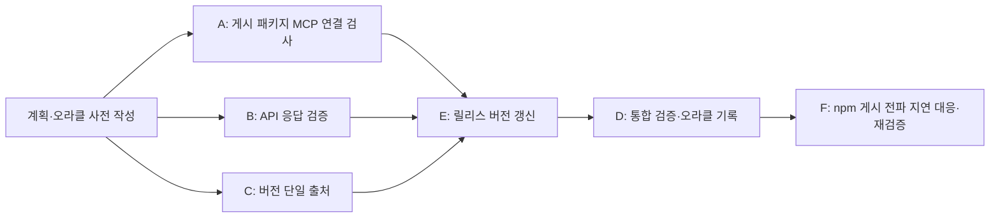

# MCP 배포·응답 신뢰성 개선 계획

## 범위와 기준

직전 MCP 개선 제안 세 가지를 구현한다: 게시된 npm 패키지의 MCP 연결 확인, 잘못된 API 성공 응답의 명시적 오류, 패키지 버전과 MCP 서버 버전의 단일 출처. 기존 도구·API 계약과 개인 토큰 방식은 유지한다. `mcp/.omc/`는 작업 범위에서 제외한다.

완료 판정은 [검증 오라클](../oracles/2026-10-18-mcp-release-reliability.md)에 미리 정의한다. 배포된 Sprint API에 실제 쓰기 요청은 보내지 않는다.

## 작업 DAG

| 작업 | 소유 파일 | 선행 | 완료 조건 |
|---|---|---|---|
| P | 이 계획, 검증 오라클 | 없음 | 구현 전에 DAG와 미체크 검증 항목 작성 |
| A | `.github/workflows/publish-mcp.yml`, `mcp/README.md`, 필요 시 `mcp/scripts/` | P | 게시된 정확한 버전의 패키지로 stdio MCP 초기화와 도구 목록 조회를 확인; PR 또는 로컬에서 실행 가능한 검사 경로와 안내 제공 |
| B | `mcp/src/client.ts`, `mcp/src/client.test.ts` | P | 2xx 비정상 JSON/계약 위반을 오류로 처리; 정상·실패 응답 회귀 검사 |
| C | `mcp/src/index.ts`, 필요한 최소 빌드 설정 | P | MCP 서버가 `mcp/package.json` 버전을 사용하며 중복 상수 제거 |
| E | `mcp/package.json`, `mcp/package-lock.json` | A, B, C | 미게시 패치 버전으로 올려 main 게시 워크플로가 새 코드를 npm에 올릴 수 있게 함 |
| D | 오라클 결과와 통합 검사 | E | 파일 충돌 확인, MCP 테스트·빌드·패키지 검사, 체크리스트에 실제 결과 기록 |
| F | `mcp/scripts/smoke-package.mjs`, 오라클 결과 | D | 게시 직후 레지스트리에 새 버전이 안 보이는 일시적 오류를 제한된 시간 동안 재시도하고 실제 게시 패키지 연결을 재검증 |

A·B·C는 파일 소유권이 겹치지 않아 병렬로 수행한다. E는 세 작업이 끝난 뒤, D는 E가 끝난 뒤 진행한다. E는 기존 게시 워크플로가 같은 버전의 재게시를 건너뛰는 규칙 때문에 통합 검토에서 추가했다. F는 첫 main 게시 실행에서 npm이 `0.4.1` 처리 중이라고 알린 직후 레지스트리 조회가 `ETARGET`으로 실패해 추가했다.
